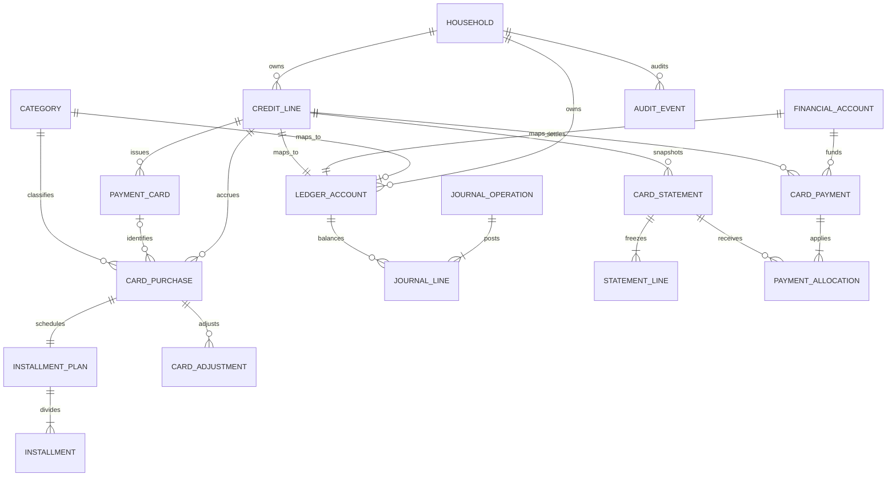
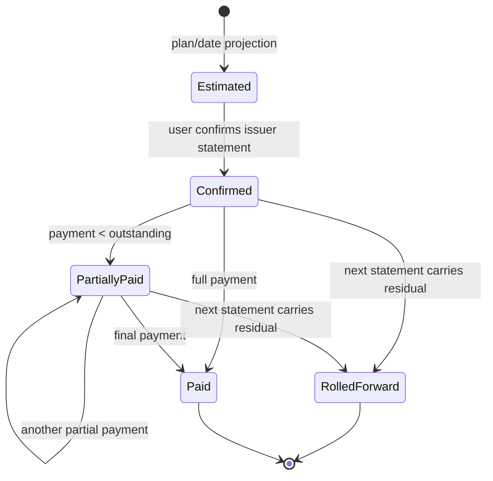
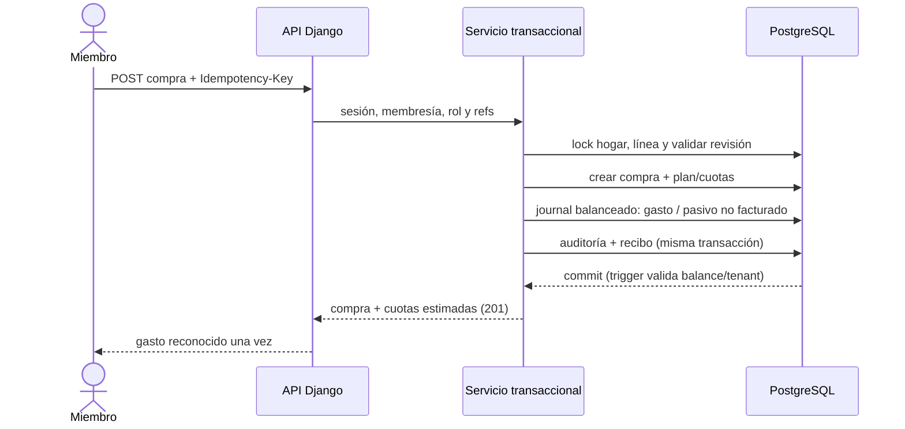

# Gastio · Fase 2.0 — Diseño de tarjetas, cuotas y pagos

**Estado:** diseño para revisión; no aprobado para implementación  
**Fecha:** 2026-10-10  
**Ámbito:** reglas contables, modelo de dominio, seguridad, contratos y plan. No se crean modelos, migraciones, endpoints ni pantallas en esta iteración.

## 1. Decisión y recomendación

La tarjeta es un **pasivo**, no una cuenta de dinero. Una compra reconoce consumo una sola vez y crea una obligación; las cuotas reparten fechas de exigibilidad, no vuelven a crear el consumo. Una liquidación reduce efectivo y pasivo; nunca es un gasto. Los pagos de resúmenes deben conciliar con pasivos, no mezclarse con los KPIs de consumo.

El libro de Fase 1 **no es un mayor de doble partida**. `LedgerEntry` sólo referencia `FinancialAccount` y representa un delta de saldo. `FinancialTransaction` exige una cuenta de dinero y limita su forma a apertura, ingreso, gasto o transferencia. La consulta de saldo suma entradas de la revisión actual de operaciones vigentes. Categoría y transacción permiten informes de consumo, pero no son contrapartidas del ledger. La inmutabilidad de `LedgerEntry` evita reescrituras; no convierte por sí sola esos deltas en un libro que admita pasivos.

Por tanto, el primer incremento de implementación debe establecer un único diario balanceado y su corte de lectura antes de registrar compras con tarjeta. No se agregará un libro de tarjeta paralelo. Los eventos actuales de Fase 1 y los nuevos eventos de tarjeta deben proyectarse en el mismo diario. La tabla histórica `LedgerEntry` se conserva durante la transición y se retira o queda como proyección de compatibilidad sólo cuando una conciliación demuestre que no vuelve a ser fuente de verdad.

Decisiones propuestas para revisión:

1. Crear un diario general con cuentas de mayor tipadas y asientos inmutables balanceados por moneda y revisión.
2. Mantener `FinancialAccount` como objeto de cuenta líquida y enlazarlo con su cuenta de mayor de activo. Crear una línea de crédito/pasivo independiente; las tarjetas adicionales son instrumentos de esa línea.
3. Mantener la compra como origen económico y las cuotas como plan de exigibilidad. El resumen confirmado congela una vista de obligaciones; no genera una segunda compra.
4. Hacer pagos con asientos de débito al pasivo y crédito a la cuenta líquida existente, con aplicaciones explícitas a resúmenes pendientes.
5. En la primera entrega operativa, usar ARS y cuotas fijas sin interés conocido. No calcular interés, pago mínimo, mora ni conversión de moneda.
6. Todas las tarjetas de esta fase son compartidas por hogar. `limited_entry` no recibe acceso hasta que exista ACL por cuenta/instrumento aplicada también a listas, diarios, resúmenes y agregados.

El diseño permite empezar Fase 2.1 después de aprobar la transición contable, las fechas de ciclo y los permisos. No autoriza programar esa fase por sí solo.

## 2. Auditoría del núcleo existente

### 2.1 Evidencia inspeccionada

Se revisaron los documentos maestros de producto, ERS, casos de uso, arquitectura, datos, API, seguridad, OAuth, UX, pruebas y roadmap; la guía de Fase 1 y el informe Fase 1.1; modelos, servicios, serializers, rutas, migraciones SQL y pruebas de `accounts`, `categories`, `households`, `wallets`, `transactions` y `audit`; y los selectores del dashboard y las interfaces Angular.

- `FinancialAccount` es una cuenta monetaria del hogar, ARS; su saldo no se guarda y se deriva de `LedgerEntry`.
- `FinancialTransaction` tiene cuenta no nula, moneda fija ARS y forma validada para `opening`, `income`, `expense` o `transfer`. Una transferencia referencia otra `FinancialAccount`.
- `LedgerEntry` referencia una cuenta monetaria y una transacción/revisión. Un ingreso o apertura tiene delta positivo; un gasto, negativo; una transferencia crea deltas opuestos. Triggers verifican signo, cantidad, referencias del hogar, consistencia y protección de filas históricas.
- La corrección incrementa la revisión y publica un conjunto nuevo de deltas; los informes de saldo sólo incluyen revisión actual `posted`. La anulación excluye la transacción de saldos y deja historial/auditoría. `expected_revision` rechaza escrituras obsoletas.
- Las escrituras usan `transaction.atomic`, bloquean el hogar y la membresía, validan todas las referencias y persisten un `WriteReceipt` con clave UUID y fingerprint. El tenant se resuelve desde `active_household_id` de sesión; `X-Household-ID` sólo detecta contexto obsoleto.
- Dashboard actual suma el saldo líquido de las cuentas; KPIs mensuales suman transacciones de ingreso/gasto por fecha efectiva. Transferencias y aperturas se excluyen de consumo. Los pagos de tarjeta todavía no existen.
- Los servicios de cuentas y tarjetas no están instalados en Django. `backend/apps/credit_cards/` sólo contiene el cascarón de la app. La API OpenAPI describe hoy el núcleo operativo de Fase 1.
- Las pruebas Fase 1.1 verifican ARS, revisiones, rollback, idempotencia, referencias cruzadas, roles existentes y aislamiento. No prueban un pasivo ni una conciliación de doble partida.

### 2.2 Consecuencia

No reutilizar un gasto ordinario cargado contra una cuenta bancaria para representar una compra con tarjeta: bajaría efectivo en el día de compra. Tampoco modelar la tarjeta como cuenta líquida negativa: sumaría deuda a fondos disponibles y rompería los agregados, validaciones y semántica de `FinancialAccount`. Un endpoint nuevo que escriba sólo `CardPurchase` y sus propias filas no relacionadas con el libro conservaría dos verdades financieras.

La adaptación debe incluir un formato de diario con líneas balanceadas, un mapeo de las cuentas monetarias/categorías existentes a cuentas de mayor y servicios de lectura comunes. Es una migración de arquitectura de alcance acotado, no un cambio que pueda ocultarse detrás de un nuevo formulario.

## 3. Requisitos

### Funcionales

| ID | Requisito propuesto | Aceptación |
|---|---|---|
| F2-RF-01 | Administrar líneas de crédito y tarjetas asociadas | La línea y cada instrumento pertenecen a un solo hogar; archivar no elimina historial |
| F2-RF-02 | Registrar compra de un pago o en cuotas fijas | Un único evento de consumo, importe final positivo y plan determinista |
| F2-RF-03 | Proyectar ciclos y obligaciones | Proyecciones se etiquetan como estimadas y no se presentan como resumen confirmado |
| F2-RF-04 | Confirmar un resumen manual | Guarda fechas/ítems observados; posteriores cambios se registran como eventos nuevos |
| F2-RF-05 | Registrar pagos parciales o completos | Cada aplicación apunta a una obligación pendiente y reduce efectivo y deuda una vez |
| F2-RF-06 | Registrar devolución/anulación trazable | No se borra una compra, cuota, aplicación o resumen confirmado |
| F2-RF-07 | Consultar pasivos y compromisos | Deuda, facturado pendiente y cuotas futuras se muestran separados |
| F2-RF-08 | Mantener idempotencia y auditoría | Reintento devuelve recibo; contenido distinto con la misma clave devuelve 409 |
| F2-RF-09 | Importar deuda anterior a Gastio | Distingue saldo de apertura y registro histórico para evitar reconocer consumo dos veces |
| F2-RF-10 | Respetar household y roles | Ningún UUID o agregación cruza hogares; denegar por defecto |

### No funcionales

- No floats. Importe ARS `Decimal(18,2)` y fechas civiles locales del hogar (`America/Argentina/Rio_Gallegos` actualmente).
- Cada revisión de diario balancea débitos y créditos en la misma moneda; las líneas son inmutables y el grupo se valida al commit en PostgreSQL.
- Operaciones multiobjeto son atómicas; `Idempotency-Key`, locks y control de revisión cubren reintentos y concurrencia.
- Preservar el contrato de sesión/CSRF, denegación por defecto, auditoría, UUID, errores y paginación existentes.
- El límite de crédito es dato informativo/configurable; Gastio no autoriza transacciones ante el emisor y no promete crédito disponible real.
- Las lecturas de saldos y resúmenes deben quedar acotadas por hogar, paginadas y medidas con los mismos criterios de rendimiento del núcleo.
- Sin PAN completo, CVV, PIN, contraseña de banca ni token del emisor. Sin sincronización bancaria en este alcance.

## 4. Reglas contables propuestas

### 4.1 Cuentas y signos

El diario usa débitos y créditos positivos, nunca importes con signo en las líneas. Para ARS, débito aumenta activos/gastos y disminuye pasivos/ingresos; crédito aumenta pasivos/ingresos y disminuye activos/gastos. Por cada evento y revisión:

`Σ débitos = Σ créditos`, `Σ débito - crédito = 0`, no hay línea con ambos valores distintos de cero y la suma por moneda también debe balancear.

Cuentas de mayor mínimas: activo líquido enlazado a `FinancialAccount`; pasivo de tarjeta enlazado a línea de crédito; gasto enlazado a categoría de gasto; ingreso enlazado a categoría de ingreso; patrimonio/apertura para balances iniciales. No crear una cuenta de mayor por tarjeta adicional: las tarjetas de una línea comparten el mismo pasivo y resumen.

### 4.2 Compra y cuotas

Una compra de ARS 100.000 en tres cuotas registra una sola vez:

| Cuenta | Débito | Crédito |
|---|---:|---:|
| Gasto de la categoría elegida | 100.000,00 | — |
| Pasivo no facturado de la línea | — | 100.000,00 |
| **Total** | **100.000,00** | **100.000,00** |

El consumo mensual se atribuye a `purchase_date`, no a cada fecha de cuota. Una compra de un pago usa `installment_count=1`; el total vence en el primer período aplicable, pero el gasto se reconoce al comprar.

En una confirmación que incluye la primera cuota de 33.333,33, sólo se reclasifica el pasivo: débito 33.333,33 al pasivo no facturado y crédito 33.333,33 al pasivo facturado. El total de la deuda no cambia. Después de pagar esa cuota, el diario debita el pasivo facturado y acredita la cuenta líquida; deuda restante = 66.666,67. No aparece un segundo gasto en la fecha del resumen o pago.

Para N cuotas, `base = floor(financed_amount / N, 0.01)`; cuotas 1…N−1 toman `base`, la última toma `financed_amount − base × (N−1)`. Se rechaza un total que no permita una cuota positiva por período (menos de N centavos). Para 100.000,00 / 3, los importes son **33.333,33 + 33.333,33 + 33.333,34 = 100.000,00**. La base de la compra, la suma de cuotas y el saldo de pasivo se concilian a centavos.

En Fase 2.1, importe facturado por el emisor = principal cargado, costo financiero modelado = 0. Se registra el importe final realmente cargado. Un precio contado opcional no altera la contabilización y se difiere; si se modela después, se separa principal, interés y cargos. No inferir intereses a partir de una diferencia ni permitir importes financiados distintos sin una partida de costo explícita.

### 4.3 Fechas y ciclos

- `purchase_date` determina el período de consumo. `attribution_date` representa la fecha de imputación que se cree que usará el emisor y determina la proyección del resumen; por defecto copia `purchase_date` y se puede corregir antes de confirmarse el período.
- Cada hogar usa su zona horaria configurada. Para estimar, el día de cierre se limita al último día real del mes (día 31 → 28/29 en febrero). La fecha de imputación igual al cierre se asigna a ese ciclo por regla Gastio; se etiqueta estimada porque el emisor puede contabilizar después.
- El período cubre los días posteriores al cierre precedente hasta el cierre actual inclusive. El primer período tiene `cycle_start` explícito al crear la línea.
- Proyección de vencimiento: día configurado y offset de mes (0 o 1), limitado al último día real. La fecha confirmada por el emisor reemplaza la estimación para ese resumen. `due_date` debe ser posterior a `closing_date`.
- Fechas estimadas se devuelven como tales. Sólo una acción de confirmación crea una instantánea del resumen. No asumir que una compra reciente ya está en un resumen confirmado.
- Cambio de cierre/vencimiento: sólo futuro. El dueño elige si se recalculan períodos y cuotas aún no confirmados; la respuesta guarda actor, configuración anterior/nueva y fecha efectiva. Resúmenes confirmados nunca se mueven ni reescriben. Un cambio de fecha de compra hacia un período confirmado se rechaza; se agrega ajuste en un período abierto.

### 4.4 Resumen y saldo exigible

Un resumen confirmado es una instantánea de: línea, fechas reales, saldo trasladado de resúmenes previos, cuotas/ajustes incluidos, total del ciclo, referencia opcional del emisor y total observado por el usuario. Si el total observado no concuerda con la proyección, no se confirma silenciosamente: se muestra la diferencia y se exige registrar/seleccionar un ajuste trazable.

El resumen no es un nuevo asiento de consumo. Al confirmarlo, las cuotas incluidas pasan de no facturadas a facturadas mediante reclasificación balanceada; el pasivo total permanece igual. Los movimientos posteriores generan proyección del período siguiente. La instantánea confirmada y sus ítems son inmutables. Una discrepancia posterior crea un ajuste o devolución en un período abierto.

Estados persistidos derivados de eventos: `confirmed`, `partially_paid`, `paid`, `rolled_forward`. Una proyección no se persiste como obligación confirmada: el API la devuelve `estimated`. Los pagos son aplicaciones inmutables. Se calcula `statement_total`, `paid_amount`, `outstanding` y fecha de vencimiento desde snapshot y aplicaciones válidas; no guardar duplicados mutables de estos totales.

Al confirmar el período siguiente, un saldo impago anterior se muestra como renglón de arrastre. El resumen anterior conserva su total histórico y transita a `rolled_forward`; el saldo exigible activo se consulta una sola vez en el resumen vigente. Las aplicaciones posteriores se hacen contra el resumen activo, para no contar el arrastre dos veces.

### 4.5 Pago, mora y excedentes

- Un pago por importe X debita pasivo facturado y acredita la cuenta monetaria elegida por X. No genera ingreso/gasto de consumo. Exige fecha, hogar, cuenta activa al momento del pago y una o más aplicaciones explícitas a resúmenes vigentes.
- La suma de aplicaciones debe igualar exactamente el pago, cada monto ser positivo y ninguna exceder saldo pendiente bloqueado y revalidado en la transacción. Dos pagos concurrentes no pueden llevar el saldo por debajo de cero.
- Pago parcial: queda obligación residual visible. Una alerta informa que interés, mora y pago mínimo del emisor no están modelados. Gastio no calcula penalidades.
- Pago superior al saldo facturado asignable, pago sin resumen confirmado y anticipo a cuotas no facturadas se rechazan con 400/409 en el primer release. No se crea un saldo a favor por una entrada de efectivo no aplicada. Pago contra varias obligaciones requiere aplicaciones explícitas, no una distribución oculta.
- Devolución de compra es un evento separado que acredita gasto y debita pasivo, con importe positivo de captura. Hasta el importe pendiente reduce deuda; excedente real del emisor queda en una cuenta/partida separada `issuer_credit_receivable`, identificada como crédito recuperable del emisor, no efectivo ni saldo disponible. Puede aplicarse a una obligación futura o registrarse su reembolso a una cuenta líquida con un evento propio.
- Anular un pago agrega una revisión que compensa sus líneas y aplicaciones; se bloquea línea, resumen y cuenta en el mismo orden transaccional. Si la cuenta líquida está archivada, se permite la compensación, preservando el historial.
- No se producen cargos automáticos por atraso, financiamiento, pago mínimo, extracción de efectivo, FX ni pagos reales al banco.

### 4.6 Anulación y corrección

Las líneas del diario no se editan ni borran. El objeto origen posee revisión esperada y registro auditado. Una corrección publica un grupo balanceado que revierte el grupo activo previo y registra el grupo corregido; el neto debe equivaler a una sola transacción actual. Una anulación publica la reversión del efecto activo. Reintentar con la misma clave reproduce respuesta; otra clave con revisión vieja obtiene 409.

Compra sin cuotas facturadas y sin pagos: puede anularse con revisión compensatoria; el plan se marca cancelado por evento, manteniendo sus cuotas históricas. Compra confirmada/facturada, pagada parcial o totalmente: no se modifica; requiere devolución/ajuste acreditado. No editar la fecha de una obligación ya incluida en un resumen confirmado. Corregir una cuota no puede borrar su asiento original: antes de confirmación, nueva revisión compensa y recalcula sólo cuotas no facturadas; después de confirmar, el cambio se refleja como ajuste futuro con auditoría.

## 5. Modelo de dominio propuesto

### 5.1 Entidades

| Entidad | Propósito / campos principales | Reglas |
|---|---|---|
| `LedgerAccount` | Cuenta de mayor; `household_id`, `kind` (asset/liability/equity/income/expense), `currency`, `system_code`, referencias opcionales a cuenta monetaria, línea de crédito o categoría | Una referencia compatible con `kind`; cuenta activa; códigos del sistema estables. Referencias mismo hogar mediante trigger diferido. |
| `JournalOperation` | Origen financiero común: `household`, actor, tipo de evento, fecha efectiva, moneda, revisión, estado, referencia UUID del origen tipado | Único dueño contable; idempotencia mediante `WriteReceipt`; evento no elimina historial. |
| `JournalLine` | `operation`, `revision`, secuencia, `ledger_account`, débito, crédito, timestamps | Una sola cara mayor que cero; moneda homogénea; grupo balanceado; append-only; tenant igual. Sustituye gradualmente el papel de saldo de `LedgerEntry`. |
| `FinancialAccount` | Activo líquido existente | Se conserva como recurso de UX/API; se enlaza 1:1 a `LedgerAccount(asset)`. No se convierte en tarjeta ni pasivo. |
| `Category` | Clasificación existente | Se enlaza a cuenta mayor expense/income. No representa un saldo del hogar. |
| `CreditLine` | Pasivo de tarjeta: nombre interno, emisor descriptivo, ARS, límite opcional, regla de cierre/vencimiento, fechas iniciales, estado y `LedgerAccount(liability)` | Unique por hogar/identificador interno; archivar no borra ni liquida deuda. Límite sólo estimativo. |
| `PaymentCard` | Instrumento adicional: línea FK, alias, red opcional, `last4` opcional, estado/fecha archivado | PAN/CVV/PIN nunca se guardan. Resumen y pasivo pertenecen a línea, no a plástico. |
| `CardPurchase` | Evento de compra: línea, plástico opcional, categoría, comercio/nota, precio final cobrado, `purchase_date`, `attribution_date`, principal, cuotas, origen, revisión y estado | Household igual en todas las referencias. Fase inicial: `price=principal`, ARS, cero cargos separados. |
| `InstallmentPlan` | Conteo, regla sin interés, principal total, revisión de plan | Una compra tiene un plan vigente; toda revisión conserva total conciliado. |
| `Installment` | Ordinal, principal, fecha imputación/cierre estimado, ciclo previsto, estado/evento de facturación | Unique(plan, ordinal); suma original exactamente principal; líneas originales inmutables. |
| `CardStatement` | Instantánea confirmada: línea, período y fechas reales, resumen anterior, referencia, total observado, confirmador, versión | Unique(line, closing date); instantánea/ítems inmutables. Estados y arrastre se derivan de confirmaciones, aplicaciones y roll-forward. |
| `StatementLine` | Snapshot de cuota, arrastre, devolución o ajuste | Renglón origen trazable, monto positivo deudor o ajuste firmado, sin doble enlace tenant. No reescribe consumo. |
| `CardPayment` | Evento de pago: línea, cuenta monetaria, monto, fecha, actor y revisión | No se elimina; la cuenta puede archivarse después del pago. |
| `PaymentAllocation` | Aplicación inmutable de pago a resumen y, si hace falta, línea | La suma coincide con el pago; suma aplicada no supera pendiente al confirmar. |
| `CardAdjustment` | Devolución, corrección de emisor o saldo de apertura con motivo/autor/fecha | Evento separado, compensatorio y auditable. Costo financiero sólo en fase posterior. |
| `IssuerCreditReceivable` | Crédito a favor originado en devolución/ajuste real y no consumido | No nace de un pago excedente; no se agrega al saldo líquido. Aplicarlo/reembolsarlo crea nuevas líneas. |
| `WriteReceipt` / `AuditEvent` | Idempotencia y antes/después | Se reutilizan los mecanismos existentes con el origen financiero común y scope hogar/actor. |

`CardCycleProjection` no es una entidad persistida: es respuesta calculada con cuotas aún no confirmadas y configuración versionada. El estado `estimated` sólo existe en el contrato de lectura. Evita que un cálculo calendario se confunda con deuda aceptada por el emisor.

### 5.2 Diagrama entidad-relación



### 5.3 Ciclo de estados



`Estimated` es efímero. Las transiciones persistidas agregan hechos/auditoría; no cambian el snapshot confirmado. Un error corregible crea ajuste vinculado.

## 6. Secuencias principales

### 6.1 Compra y cuota



### 6.2 Confirmación de resumen

```mermaid
sequenceDiagram
  actor U as Owner/Admin
  participant API as API Django
  participant S as Servicio de dominio
  participant DB as PostgreSQL
  U->>API: confirmar ciclo + fechas y total observado
  API->>S: lock hogar/línea; verificar ciclo vigente
  S->>DB: recalcular proyección; congelar items/fechas
  S->>S: comparar total esperado con total observado
  alt diferencia sin ajuste explicado
    S-->>API: 409/422 con diferencia; ningún resumen confirmado
  else conciliación explícita
    S->>DB: reclassificar pasivo no facturado a facturado
    S->>DB: snapshot + audit + WriteReceipt (atómico)
    DB-->>S: commit con invariantes
    S-->>API: resumen confirmado y saldo pendiente
  end
```

### 6.3 Pago parcial

```mermaid
sequenceDiagram
  actor U as Miembro
  participant API as API Django
  participant S as Servicio de pago
  participant DB as PostgreSQL
  U->>API: POST pago + cuenta + aplicaciones + clave
  API->>S: autorizar; lock hogar, línea, resúmenes, cuenta
  S->>DB: comprobar pendiente y suma de aplicaciones
  S->>DB: journal: débito pasivo / crédito efectivo
  S->>DB: guardar PaymentAllocation, auditoría y recibo
  DB-->>S: commit atómico y balanceado
  S-->>API: pago, aplicado y pendiente restante
  API-->>U: aviso de interés/mora no modelados si parcial/tardío
```

## 7. Casos de uso

- **Administrar línea/plásticos (Owner/Admin):** alta de línea, ciclo, vencimiento, límite informativo y plásticos; validar tenant y permisos; archivar sin borrar pasivo. Miembros pueden consultar líneas compartidas.
- **Registrar consumo (Miembro):** elige tarjeta, categoría, importe final, fecha y cuotas; revisa importes/fechas; confirma. API calcula total exacto y crea evento, diario y calendario en una transacción.
- **Confirmar resumen (Owner/Admin):** compara resumen del emisor, fechas y período con proyección; resuelve diferencias vía ajuste y confirma una sola vez.
- **Pagar obligación (Miembro autorizado):** elige cuenta líquida y resumen pendiente; decide importe y asignación; revisa salida efectiva/pasivo residual; confirma. No ofrece pago sin obligación facturada ni importe mayor al saldo aplicable.
- **Devolver/anular consumo:** motivo, importe positivo y fecha de la devolución. Si compra aún no fue facturada y no hay pago, puede anularse; después se registra nota de crédito/ajuste, manteniendo el resumen original.
- **Importar situación inicial:** dueño ingresa saldo de apertura y cuotas pendientes como apertura de deuda contra patrimonio inicial, sin inflar gasto del mes. Si carga compras históricas pagadas, sólo se habilitan como historial sin asiento/liability; no pueden volver a afectar dashboard de consumo. Una importación con deuda viva incluye su calendario remanente y conciliación de saldo.

## 8. API propuesta

Todos los endpoints requieren sesión, CSRF en mutación, hogar activo, autorización server-side y `Idempotency-Key` UUID en escrituras. El hogar no se acepta desde body. Respuestas de listas usan paginación estable; importes son strings decimales; fechas civiles `YYYY-MM-DD`; conflictos de revisión/idempotencia 409. Estos contratos son propuestas para OpenAPI futuro; **no existen todavía**.

| Método y ruta propuesta | Uso |
|---|---|
| `GET/POST /api/v1/credit-lines/` | Lista o alta de pasivos compartidos |
| `GET/PATCH /api/v1/credit-lines/{id}/` | Detalle/ciclo/límite informativo; update con revisión |
| `GET/POST /api/v1/credit-lines/{id}/cards/` | Instrumentos adicionales, sin PAN |
| `POST /api/v1/card-purchases/` | Compra de un pago o en cuotas sin interés |
| `GET /api/v1/card-purchases/` | Compras con filtros fecha, línea, tarjeta, categoría, estado |
| `PATCH /api/v1/card-purchases/{id}/` | Corregir sólo antes de confirmación/facturación, `expected_revision` |
| `POST /api/v1/card-purchases/{id}/void/` | Anular sólo si cumple reglas; de otro modo 409 y usar devolución |
| `POST /api/v1/card-purchases/{id}/refunds/` | Devolución/nota de crédito con motivo, monto y fecha |
| `GET /api/v1/credit-lines/{id}/projections/?from=&to=` | Resúmenes/cuotas estimados, claramente no confirmados |
| `GET/POST /api/v1/card-statements/` | Lista/confirmación manual de resumen; ningún update destructivo |
| `POST /api/v1/card-statements/{id}/payments/` | Pago y aplicaciones explícitas desde cuenta existente |
| `GET /api/v1/card-payments/{id}/` | Detalle/auditoría; anulación por endpoint separado y revisionado |
| `GET /api/v1/dashboard/summary/?month=` | KPIs actuales más nuevos campos separados de tarjeta |
| `GET /api/v1/card-obligations/?from=&to=` | Calendario facturado y proyectado paginado |

### Ejemplo de compra

```json
POST /api/v1/card-purchases/
Idempotency-Key: 0c52e5ef-93c9-4a9f-bb16-0f2a0ccde118
{
  "credit_line_id": "uuid",
  "card_id": "uuid",
  "category_id": "uuid",
  "purchase_date": "2026-10-10",
  "attribution_date": "2026-10-10",
  "amount": "100000.00",
  "installment_count": 3,
  "merchant": "Comercio",
  "description": "Electrodoméstico"
}
```

Respuesta 201 incluye compra, revisión, importe de consumo `100000.00`, cuotas `[33333.33,33333.33,33333.34]`, ciclo estimado y estado `estimated`. El `summary` no se devuelve como confirmado.

### Ejemplo de pago

```json
POST /api/v1/card-statements/{statement_id}/payments/
Idempotency-Key: 95a9f921-5d02-4cc9-aebf-9e41d4e8cdcb
{
  "funding_account_id": "uuid",
  "paid_on": "2026-11-10",
  "amount": "20000.00",
  "allocations": [{"statement_id": "uuid", "amount": "20000.00"}]
}
```

La respuesta incluye `cash_delta: "-20000.00"`, `debt_delta: "-20000.00"`, `consumption_delta: "0.00"`, estado y saldo pendientes. Los deltas son explicativos; el diario y los reportes son fuente.

### Dashboard

No cambiar el sentido de `balance`: sigue siendo saldo líquido consolidado, no dinero libre después de tarjetas. Agregar campos independientes: `cash_balance`, `card_debt_total`, `card_billed_outstanding`, `card_unbilled_principal`, `card_future_installments`, `next_card_due_date`, `next_card_due_amount`, `card_payments_period`, `card_consumption_period`. Si se conserva `balance` por compatibilidad, documentarlo como alias temporal de `cash_balance` y versionar/retirar sólo con decisión de API.

`income` y `expense` actuales deben evolucionar para sumar ingresos/gastos de consumo en efectivo y tarjeta por fecha de reconocimiento, excluyendo pagos y transferencias. La compatibilidad de antiguos clientes debe evaluarse: agregar `cash_expense` y `card_expense` durante transición y mantener el significado histórico de `expense` hasta versionar contrato si los clientes ya dependen de él. No sumar `card_debt_total` a `cash_balance` ni contar `future_installments` además del pasivo. Presupuesto futuro observará compras/refunds netos por categoría, no cuotas ni pagos.

## 9. Seguridad, roles e invariantes

### Permisos iniciales de tarjetas compartidas

| Acción | Owner/Admin | Member | Limited entry |
|---|---|---|---|
| Crear/editar línea, ciclo y plásticos | Sí | No | No |
| Ver deuda, compra, cuota y resumen | Todo el hogar activo | Todo el hogar activo | 403 hasta ACL explícita |
| Crear compra con tarjeta compartida | Sí | Sí | No |
| Corregir/anular compra | Cualquiera antes de confirmarse o propio según autorización; decisión del hogar debe quedar uniforme | Propia antes de confirmarse | No |
| Confirmar resumen/configurar importación | Sí | No | No |
| Registrar pago/devolución | Sí | Sí, con control de cuenta y obligaciones | No |
| Revertir pago | Cualquiera con permiso admin; miembro sólo su pago y mientras validen guardas | Según regla | No |

Para primera entrega, el modelo sólo tiene instrumentos compartidos del hogar, en consistencia con Fase 1.1. No declarar una tarjeta privada por miembro ni filtrar sólo el nombre dejando visible su deuda en totales. Antes de `limited_entry` o privacidad individual, implementar ACL centralizada sobre línea/tarjeta/compra/resumen, account de pago, journal entries y todas las agregaciones. Aislamiento tenant precede al lookup de cada objeto; FK compuesta/trigger PostgreSQL verifica que `household_id` coincide para línea, tarjeta, categoría, cuenta líquida, resumen, pago y asignaciones.

### Invariantes DB/servicio

1. Cada `JournalOperation` y revisión tiene ≥2 líneas; todas las líneas son no nulas, positivas en exactamente débito o crédito, y balancean en su moneda.
2. Cada cuenta mayor y objeto origen comparte hogar y moneda. La constraint/triggers diferidos repiten validaciones de API al commit.
3. Compra ARS positiva; plan tiene N≥1; ordinales únicos y contiguos; suma de cuotas originales exactamente igual al principal. No floats ni recalcular con formato UI.
4. El plan y resumen confirmados no se editan/borran. Cambios agregan revisión/reversión/ajuste con actor, fecha y evidencia anterior/posterior.
5. Resumen confirmado es único por línea/cierre; sólo se confirman fechas/ciclos no confirmados y ningún período se superpone o queda en hueco.
6. Pago tiene importe positivo y cuenta de fondos; suma de aplicaciones = importe; total aplicado no supera saldo exigible bloqueado en la transacción.
7. La misma `Idempotency-Key` hogar/actor sólo produce una operación. Mismo fingerprint devuelve 200/resultado original; otro payload, 409.
8. Compra, cuotas, journal lines, auditoría y recibo se confirman/rollback juntos. Confirmación de resumen y pago/aplicaciones también son atómicos.
9. Anulación no borra compra ni resume de nuevo consumo; devolución no crea un gasto positivo accidental. Pago no vuelve a registrar el consumo.
10. Cuentas archivadas, líneas/plásticos archivados y categorías inactivas no se pueden seleccionar en eventos nuevos; se mantienen para lectura y compensaciones necesarias.
11. Cuenta de pago permanece en ARS y no puede pertenecer a otro hogar. La política vigente de saldos líquidos negativos se conserva, pero el pasivo y el límite de crédito no se esconden dentro de ella.
12. Confirmar saldo observado distinto de proyección necesita ajuste explícito y auditado. No aceptar cambios silenciosos ni confiar en totales enviados por Angular.

### Concurrencia

Todas las escrituras siguen orden de locks: hogar, membresía (revalidación), línea(s) en orden UUID, resumen(es) en orden de período/UUID y cuenta(s) líquida(s) en orden UUID. La implementación actual serializa escrituras de un hogar bloqueando su raíz; reutilizar inicialmente ese mecanismo y medir contención antes de sustituirlo. Aunque haya serialización por hogar, locks de dominio protegen invariantes cuando se creen workers/otras rutas. Las constraints únicas resuelven doble confirmación; `expected_revision`/ETag da 409 a UI obsoleta. Nunca confiar sólo en la secuencia del frontend.

## 10. Matriz de pruebas/aceptación

Los montos de prueba son ARS; para prueba de tres cuotas, saldo de apertura y asientos indicados son expectativas de libro. Todos los casos incluyen hogar activo y CSRF cuando hay mutación.

| ID | Escenario / preparación | Resultado verificable |
|---|---|---|
| C01 | Compra un pago por 10.000 | Gasto +10.000 una vez; pasivo +10.000; efectivo sin cambio; journal balancea |
| C02 | 100.000 en 3 cuotas | 33.333,33 + 33.333,33 + 33.333,34; consumo 100.000 sólo en purchase_date; deuda total 100.000 |
| C03 | Imputación posterior al cierre | Ciclo estimado siguiente; ciclo presente no la incluye; sin alterar purchase_date/mes de consumo |
| C04 | Precio 0,01 en 3 cuotas | Rechazo 400; no crea compra, plan, asiento ni recibo exitoso |
| C05 | Confirmar primera cuota C02 | Pasivo no facturado ↓33.333,33, facturado ↑igual; total deuda =100.000; snapshot immutable |
| C06 | Pago completo de C01/C05 | Efectivo ↓importe pagado; pasivo ↓igual; gasto permanece una sola vez; pendiente=0 |
| C07 | Pago parcial 20.000 a resumen 33.333,33 | Efectivo y pasivo ↓20.000; pendiente=13.333,33, aviso de intereses no modelados |
| C08 | Dos pagos distintos sobre resumen | Aplicaciones suman hasta saldo; final pagado; ninguna factura nueva ni consumo adicional |
| C09 | Reintento pago tras perder respuesta | Misma key devuelve original; sólo un delta de efectivo/pasivo y una auditoría de creación |
| C10 | Importe pago > deuda aplicable / pago anticipado sin resumen | 400/409, no se crea efectivo ni crédito artificial |
| C11 | Anular compra no facturada/sin pagos | Revisión compensa el principal; cuotas canceladas por evento; gasto/deuda netos cero |
| C12 | Devolución posterior al cierre | Resumen original intacto; asiento nuevo acredita gasto/debita deuda; crédito excedente figura como activo del emisor separado |
| C13 | Compra/refund con línea o categoría de hogar B | 404/400; rollback total; saldos, diario y recibos del hogar A sin cambio |
| C14 | Miembro A consulta UUID de compra de hogar B; user pertenece A/B | 404; datos y aggregates sólo de hogar activo; cambio de header no concede acceso |
| C15 | Dos compras/pagos concurrentes con misma key | Una única operación; replay determinista |
| C16 | Dos pagos concurrentes intentan consumir mismo saldo 50 | Una confirma; la otra queda conflicto/revalidación, pendiente nunca negativo |
| C17 | Owner cambia cierre con forecast abierto | Auditoría del antes/después; reforecast solo si confirma aplicar a ciclos abiertos; ciclos confirmados iguales |
| C18 | Archivar tarjeta con deuda 100 | No compras nuevas; deuda/resumen/pagos visibles y registrables; no DELETE |
| C19 | Importar deuda antigua 40.000 y 2 cuotas remanentes | Deuda de apertura 40.000; cuotas pendientes suman 40.000; no gasto del mes de alta |
| C20 | Compra histórica ya cancelada/importada | Sólo historial; no afecta pasivo, caja, consumo actual ni calendario |
| C21 | Confirmar resumen y luego registrar compra nueva | Snapshot ya confirmado no cambia; compra queda en siguiente ciclo estimado |
| C22 | Forzar error tras crear líneas antes de recibo | Rollback de compra, cuotas, journal, auditoría y recibo; ninguna parcialidad |
| C23 | Corregir cuota no facturada con revisión anterior | 409; revisión nueva compensada; total del plan exacto |
| C24 | Corregir cuota ya incluida en resumen | Rechazo de edición; adjustment futuro auditable; snapshot original idéntico |
| C25 | Dashboard sin tarjetas / luego compra y pago | Cero/empty states; compra aumenta consumo una vez; pago sólo reduce caja/deuda |
| C26 | Compra en fecha exacta de cierre; c31 y febrero | Cierre estimado inclusivo y día limitado correctamente; etiqueta estimated hasta confirmar |
| C27 | Crédito emisor real mayor a deuda después de refund | Deuda no negativa; excedente visible como receivable, nunca como efectivo/saldo líquido |
| C28 | Cuenta de fondos archivada tras pago | Historial legible; compensación autorizada puede ejecutarse sin reactivar ni editar cuenta |

DoD de cada vertical: contrato OpenAPI, servicios atómicos, constraints/triggers, aislamiento por hogar/rol, UI responsiva y estados de error, casos backend PostgreSQL, Angular y Playwright que cubran el recorrido, migrations check, lint/build y reconciliación manual de importes. Casos C11/C12/C24 requieren UI de devolución/ajuste, no edición destructiva.

## 11. Plan de migraciones y compatibilidad

No se aplica ninguna migración durante Fase 2.0. Antes de la primera migración:

1. ADR contable aprobado; inventario del volumen de `FinancialTransaction`, `LedgerEntry` por revisión, anulaciones, auditoría y cuentas/categorías.
2. Herramienta de preflight **read-only** informa filas que no pueden reconstruirse y checksum de balances actuales por hogar/cuenta. Reconstruir atributos de cada revisión usando snapshot actual y `AuditEvent.before/after`; no inventar categoría/cuenta histórica. Si falta evidencia, la migración aborta y requiere reparación auditada explícita.
3. Migración aditiva crea `LedgerAccount`, `JournalOperation`, `JournalLine` y enlaces 1:1 a cuenta/categoría, primero nullable. Backfill crea cuentas de mayor para cada cuenta, categoría y patrimonio inicial. Cada revisión antigua se transforma a delta histórico balanceado: gasto = débito gasto/crédito activo; ingreso = débito activo/crédito ingreso; transferencia dos activos; apertura activo/patrimonio. Correcciones/anulaciones requieren reconstrucción de snapshots y compensaciones de secuencia.
4. Reconciliar por transacción/revisión y por hogar: total débito=crédito, balance líquido nuevo idéntico al endpoint anterior, ingreso/gasto por período/categoría idénticos a la API vigente, anulaciones neto cero, referencias sin hogar cruzado. Exportar conteos y hashes a reporte interno sin PII.
5. Cutover transaccional/ventana de mantenimiento: nuevas escrituras van sólo al diario común; saldos y dashboard leen la proyección común. No habilitar rutas card hasta que ningún escritor viejo pueda insertar deltas legacy. La API pública cash conserva su shape y mismas respuestas.
6. Mantener columnas/modelos legados en sólo lectura durante una versión de respaldo; comparar dual-read sólo como validación (nunca sumar ambas). Retirarlas después de un ciclo de conciliación y backup restaurable.
7. Migraciones siguientes crean líneas/plásticos, compras/planes, resúmenes y pagos por sus incrementos. Cada migration es aditiva, reversible antes de datos confirmados; después de datos reales, rollback significa forward-fix con asiento compensatorio, no borrar historia.

**Riesgo de backfill:** revisiones previas no guardan categoría directamente en `LedgerEntry`; dependen de auditoría antes/después. Si no puede reconstruirse, no migrar silenciosamente ni atribuir todo a una categoría genérica. Resolver filas con un informe y aprobación/ajuste por hogar antes del cutover.

### Alternativas descartadas

- Tarjeta como `FinancialAccount` o balance negativo: mezcla efectivo, deuda y disponibilidad; no es compatible con constraints/dashboard y falsea saldos.
- Ledger privado de tarjetas además del ledger actual: dos fuentes de verdad y riesgo de pagar sin conciliar la caja o duplicar consumo.
- Crear compra como gasto en efectivo y luego pago como transferencia: baja caja en la fecha equivocada y no representa el pasivo.
- Registrar cada cuota como gasto: repite consumo total al cerrar meses; no debe usarse aunque facilite el dashboard.
- Confirmar statement sólo como snapshot informativo sin reclasificación del pasivo: pierde distinción entre deuda no facturada y obligación exigible.
- Mutar cuotas/resúmenes para “corregir”: destruye historia y hace imposible conciliar comprobantes del emisor.
- Autopagar o consumir crédito real desde el límite configurado: el límite no equivale al disponible informado por el banco ni hay integración bancaria.

## 12. Riesgos, decisiones pendientes y seguimiento

| Riesgo/decisión | Resolución propuesta antes de código | Consecuencia si no se decide |
|---|---|---|
| Backfill de categoría/revisión histórica | Preflight reconstruible desde AuditEvent, reconciliation por tenant | Dashboard puede cambiar retrospectivamente o perder trazabilidad |
| Importes que no coinciden con proyección | Dueño registra diferencia/ajuste con documento y confirma | Snapshot del emisor no concilia |
| Fecha de imputación real del emisor | Usuario puede corregir antes del cierre; ciclo siempre estimado hasta confirmar | Cuota cae en período incorrecto |
| Pagos parciales sin interés/mora | Pendiente visible y advertencia; sin cálculo predictivo | No prometer saldo final de banco |
| Sobrepago/anticipos | Rechazar pagos no asignables; sólo crédito real por devolución se vuelve receivable explícito | Crédito ficticio o caja inflada |
| ACL privada/carga limitada | Mantener tarjetas compartidas; ACL previa a privacidad | IDOR o fuga de agregados por totales |
| Bloqueo de hogar | Reutilizar primero lock actual; medir hogares con alto volumen | Contención si el diario se usa intensamente |
| Cambios de API dashboard | Campos nuevos, contrato/versionado sin alterar `balance` | Cliente interpreta deuda como liquidez |
| Datos bancarios sensibles | Almacenar sólo alias/red/last4 opcional; política de retención | Alcance PCI/datos sensibles innecesario |
| Interés, impuesto y cargos | Futuro módulo de cargos/periodificación separado del principal | Diferencias que se atribuyen mal a cuotas |
| Tarjetas en distintas monedas | Sólo ARS en primer release | No hay conversión/tipo de cambio trazable |
| Ciclo mensual variable | Persistir fechas reales por statement; política sólo estima | Día 29/30/31 y feriados no coinciden con emisor |

Decisiones a ratificar: due date offset por hogar/emisor; quién puede confirmar un resumen; si miembro puede pagar/revertir pago ajeno; tolerancia exacta a discrepancia (propuesta cero sin ajuste explícito); regla UI para tarjeta archivada; fechas límite de corrección y reembolso. Defaults anteriores son recomendación, no requisito implementado.

## 13. Roadmap vertical de implementación

### Fase 2.1 — Libro balanceado, tarjetas y compras

- Fundamento: diario general, mapeo de cuentas/categorías, backfill validado y cutover compatible. Este trabajo es condición de habilitación de compras, no un ledger nuevo exclusivo de tarjetas.
- Backend/API: líneas de crédito, tarjetas adicionales, compras de un pago y cuotas fijas sin interés, eventos/auditoría/idempotencia, asientos balanceados; rechazo de cuenta/categoría/plástico cruzados.
- Angular: administrar línea/plásticos, cargar compra corta, ver cuotas estimadas; sin pagar ni declarar resúmenes.
- Pruebas: C01–C04, C11, C13–C16, C18–C20, C22 y dashboard no duplicado para compra.
- Salida: reconciliación histórica firmada, saldo de caja idéntico al previo, el dashboard cuenta consumo por fecha de compra.

### Fase 2.2 — Ciclos, proyecciones y resúmenes

- Backend/API: política versionada de ciclo, proyección, confirmación manual, snapshot/ítems, diferencias y ajustes, arrastre.
- Angular: calendario mensual y confirmación conciliada; se separan forecast y resumen observado.
- Pruebas: C03, C05, C17, C21, C24, C26, cambios de fecha, cierres 31/febrero.
- Salida: snapshot confirmado inmutable; total programado y confirmado explicable contra asientos.

### Fase 2.3 — Pagos, deuda y compromisos

- Backend/API: pago parcial/total, asignación, residual, reversión, refund/issuer credit, límites de sobrepago.
- Angular: selección de cuenta existente, aplicaciones explícitas, deuda y vencimientos, advertencia de interés faltante.
- Dashboard: deuda total y facturado pendiente separadas, futuros compromisos y pagos de período sin volver a contar consumo.
- Pruebas: C06–C10, C12, C16, C27–C28, pago tardío sin cálculo de intereses.
- Salida: suma de diario por hogar/cuenta/línea concilia; ningún pago convierte el consumo previo en otro gasto.

Cada vertical debe entregar backend, contrato OpenAPI, Angular y pruebas automatizadas en su propio alcance. Ninguna empieza hasta que criterios de salida anteriores pasen en PostgreSQL aislado; nunca apuntar suites a `gastio_db`.

## 14. Fuera de esta iteración

No hay código financiero, modelos, endpoints, UI, migraciones, pruebas nuevas ejecutables ni modificaciones a `gastio_db`. No se calculan intereses, cuotas con tasas, mora, mínimo, autopago, conexión bancaria, FX, presupuestos, tarjetas privadas o integración del emisor. No hay commit ni push.
