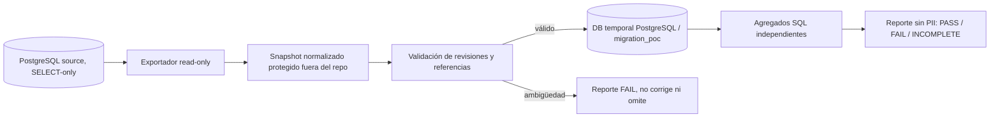
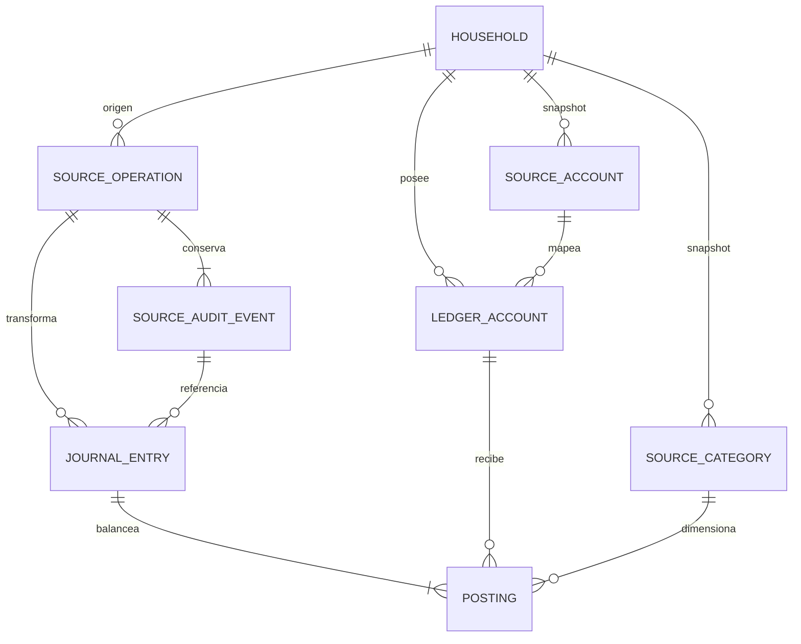

# Gastio · Fase 2.0b — Prueba aislada de migración al diario balanceado

**Estado:** POC experimental; ADR-002 continúa pendiente.  
**Fecha:** 2026-10-10  
**Resultado comprobado:** fixtures sintéticos en PostgreSQL 18.6: 11 pruebas aprobadas.  
**Historial real:** no ejecutado; no se estableció conexión de solo lectura a datos de desarrollo ni a `gastio_db`.

## Objetivo y alcance

Probar que el historial modelado por Fase 1 puede transformarse de forma determinista a postings de doble partida, con trazabilidad de revisiones y conciliación independiente. Esto no es migración productiva: las estructuras viven bajo el esquema PostgreSQL `migration_poc`; no hay modelos Django, migration graph, endpoints, frontend ni escrituras al ledger real.

La prueba no habilita corte ni tarjetas. El estado PASS que puede emitir el POC se refiere al snapshot que recibió. Un PASS de fixtures no demuestra cobertura ni paridad del historial real; ADR-002 requiere ambos.

## Semántica histórica verificada en código/tests

`FinancialTransaction` es el snapshot vigente mutable con `revision`; `LedgerEntry` es un conjunto de deltas firmados inmutables por revisión. No son compensaciones: el saldo suma sólo las entradas de la revisión actual si el objeto está `posted`. Una corrección agrega una fotografía completa de los nuevos deltas y deja inertes para saldo las revisiones anteriores. Una anulación marca el objeto `voided`; no agrega otra revisión ni borra sus deltas. `AuditEvent` contiene snapshots `before/after`, autor, timestamp y la evidencia de cada mutación; triggers diferidos exigen auditoría para la revisión vigente. El `WriteReceipt` deduplica solicitud por hogar/actor/UUID/fingerprint, pero no representa un movimiento contable.

Por eso el POC valida deltas source agrupados por revisión y reconstruye auditoría como secuencia de snapshots. Cada corrección crea una reversión de la fotografía previa y un efecto de la nueva; la anulación revierte sólo el efecto vigente. No convierte cada revisión en una nueva compra/ingreso/gasto. El asiento compensatorio usa fecha económica del efecto revertido para conservar los reportes vigentes por período; `recorded_at` conserva cuándo se registró la corrección.

## Arquitectura experimental

El código POC está aislado de `INSTALLED_APPS` y no importa modelos ORM:

- `backend/tools/ledger_migration_poc.py`: validador puro, transformación determinista, carga atómica, guards PostgreSQL, conciliación independiente y reporte JSON redacted.
- `backend/tools/export_financial_snapshot.py`: exportador PostgreSQL de solo lectura a un snapshot normalizado fuera del repositorio. Sólo consulta las tablas financieras necesarias; elimina nombres, descripción/notas, hogares descriptivos y PII de snapshots. Conserva UUID del actor de auditoría para trazabilidad en el snapshot protegido; ese UUID nunca se incluye en el reporte. Los montos/UUID siguen siendo sensibles y el archivo debe protegerse y eliminarse tras el ensayo.
- `backend/tests/test_ledger_migration_poc.py`: datos sintéticos creados en código, ejecutables sólo con `GASTIO_POC_TEST_DSN` apuntando a base PostgreSQL dedicada.

El POC exige que el nombre de base destino comience con `gastio_migration_test_`; la opción destructiva `--reset-poc-schema` sólo elimina el schema `migration_poc` de esa base. No admite SQLite. La exportación exige una ruta fuera del repositorio y recomienda rol source con privilegio `SELECT` únicamente y transacción `READ ONLY`.



### Esquema temporal



`source_operation`, `source_audit_event`, cuentas/categorías fuente, `ledger_account`, `journal_entry` y `posting` sólo existen en el schema POC. FKs compuestas `(household_id,id)` previenen referencias cruzadas en líneas, origen y dimensiones. UUID fuente se preserva. Cuentas/categorías archivadas o inactivas se importan como referencias históricas, no se reactivan.

Por cada asiento y moneda, un trigger de constraint diferido comprueba al commit que hay al menos dos líneas, que hay una sola moneda y que débito suma crédito. La cabecera se crea en estado no posteado, se agregan las líneas y luego se sella dentro de la transacción. Trigger de inmutabilidad rechaza edición/borrado de asientos posteados y de sus líneas. Unique constraints y advisory transaction lock hacen que replay concurrente sea idempotente. Esto es un prototipo; el trigger y estrategia de lock deben pasar revisión antes de migración productiva.

## Correspondencia aplicada

| Operación | Diario de prueba |
|---|---|
| Apertura | Débito activo monetario / crédito patrimonio inicial |
| Ingreso | Débito activo / crédito ingreso con dimensión categoría |
| Gasto | Débito gasto con dimensión categoría / crédito activo |
| Transferencia | Débito activo destino / crédito activo origen; nunca ingreso/gasto |
| Corrección R→R+1 | Reversión exacta de R por cada línea y efecto completo R+1; ambos balanceados y enlazados a UUID/evento fuente |
| Anulación | Reversión exacta de la última revisión; estado origen voided, historial no se borra |
| Retroactivo | Fecha económica efectiva histórica y fecha de registro separada |
| Cuenta/categoría archivada | Se preserva UUID, hogar y clase como dimensión; no se crean operaciones nuevas |
| Receipt previo | Se considera metadato de deduplicación; no crea posting. Reejecutar snapshot no duplica journal |

Débitos/créditos usan `Decimal` y ARS en esta versión, sin floats. Los saldos líquidos negativos se mantienen como activo firmado para paridad con Fase 1; el POC no inventa un préstamo/sobregiro.

## Fixtures y resultados ejecutados

El fixture generado por pytest contiene dos hogares, tres cuentas (incluida cuenta archivada), categorías activas/inactivas, aperturas, ingreso, gasto con corrección de importe y posteriores cambios de categoría/cuenta/fecha, transferencia, retroactivo, anulación directa y anulación tras corrección. Incluye montos centesimales no enteros. Las otras pruebas cubren referencia cross-tenant, replay idempotente, dos cargas concurrentes, snapshot/audit incompleto, rollback por interrupción y asiento incompleto/desbalanceado.

| Prueba | Resultado |
|---|---|
| Transformación determinista; 16 asientos con 2+ líneas, débitos=créditos; transferencias sin P&L | PASS |
| Carga PostgreSQL real, balanceo y reejecución sin duplicados | PASS |
| Interrupción simulada a mitad de la transacción; rollback completo y rerun | PASS |
| Trigger PostgreSQL rechaza asiento incompleto al commit | PASS |
| Referencias hogar/cuenta/categoría cruzadas fallan cerradamente | PASS |
| Filas source de ledger y auditoría atribuidas a otro hogar fallan | PASS |
| Dos workers cargan el mismo snapshot sin duplicar asientos | PASS |
| Cadena de auditoría incompleta se reporta como excepción | PASS |
| Snapshot histórico incompleto no se completa con valores actuales | PASS |
| Conciliación independiente de caja por cuenta, income/expense por mes y categoría, aperturas y transferencias | PASS |
| Reporte estructurado PASS sin campos personales; interrupción reportada INCOMPLETE | PASS |

El snapshot sintético final tuvo 2 hogares, 3 cuentas, 8 operaciones (6 vigentes,
2 anuladas), 11 revisiones, 13 eventos de auditoría, 4 receipts, 16 asientos y 32
postings. Se conciliaron 4 cortes distintos de registro, más el estado final, sin
diferencias. Estas cifras describen exclusivamente fixtures generados por la suite.

**Comando ejecutado:** `PYTEST_DISABLE_PLUGIN_AUTOLOAD=1 GASTIO_POC_TEST_DSN=… python -m pytest -c /dev/null -p no:cacheprovider tests/test_ledger_migration_poc.py -q`, en backend, contra PostgreSQL 18.6 efímero en `/tmp`; resultado **11 passed**. Se desactivó auto-carga pytest para no inicializar settings Django, y la suite abre directamente la DB temporal POC. Las warnings de `sys.prefix` provienen de invocar el venv desde `backend/../.venv`; no afectaron resultados. No se ejecutó la suite financiera de Django ni se cambió sus modelos.

El reporte JSON de prueba no se conserva como dato de negocio: `run()` lo genera en la ruta indicada. El test verifica `status=PASS`, `balanced=true`, `coverage_complete=true`, `reconciled=true` y ausencia de campos personales. La simulación de interrupción verifica `status=INCOMPLETE`, `reconciled=false` y cero filas de journal después de rollback.

## Ejecución reproducible

### Crear clúster PostgreSQL desechable

No requiere Docker. Use una ruta única dentro de `/tmp`, no una instalación/servicio del sistema:

```bash
PGDATA=/tmp/gastio-ledger-poc-pgdata
SOCKET=/tmp/gastio-ledger-poc-socket
mkdir -m 700 "$SOCKET"
initdb -D "$PGDATA" -A trust --no-locale -E UTF8
pg_ctl -D "$PGDATA" -o "-p 55432 -h '' -k $SOCKET" -l /tmp/gastio-ledger-poc.log start
createdb -h "$SOCKET" -p 55432 gastio_migration_test_local
```

Establezca `GASTIO_POC_TEST_DSN='dbname=gastio_migration_test_local user=<usuario> host=/tmp/gastio-ledger-poc-socket port=55432'` para correr pruebas. Nunca use la URL normal de Gastio como destino. Limpieza: cerrar conexiones, `dropdb` **sólo** `gastio_migration_test_local`, después `pg_ctl -D "$PGDATA" stop -m fast`; eliminar manualmente únicamente los dos paths únicos que creó este procedimiento. No use `dropdb --if-exists` contra nombres externos ni borre directorios preexistentes.

### Exportar y ejecutar copia de historial (pendiente)

Cuando haya un PostgreSQL origen accesible, crear un usuario read-only por grants y fijar `GASTIO_SOURCE_RO_DSN` fuera de archivos/repositorio. Exportar con `python tools/export_financial_snapshot.py --output /tmp/gastio-ledger-source-snapshot.json`; confirmar el conteo agregado y proteger archivo. Para destino configure `GASTIO_POC_DSN` a base prefijada temporal y ejecute `python tools/ledger_migration_poc.py --input /tmp/gastio-ledger-source-snapshot.json --report /tmp/gastio-ledger-poc-report.json --reset-poc-schema`. Revisar `PASS`; `FAIL` y `INCOMPLETE` no autorizan ningún corte. Mantener snapshot y reporte fuera de Git y eliminarlos cuando cierre el ensayo, según política de retención.

La exportación de historial real no fue ejecutada: el socket PostgreSQL por defecto no respondió (`pg_isready`) y no se usó ni inspeccionó `.env`. Sí se inició un clúster temporal propio para los fixtures; no se conectó a `gastio_db` ni se intentó copiar datos reales. Por tanto, la cobertura histórica real sigue **no evaluada**, no “PASS”.

## Cobertura y limitaciones

La suite demuestra el mecanismo, no la integridad de filas del ambiente real. En snapshot real el importador exige audit chain create→updates sin saltos, `before` idéntico a snapshot anterior, current row igual al último `after`, ledger delta correcto por cada revisión, FK tenant/clase/moneda y auditoría de void. Cualquier ambigüedad detiene toda la transformación; no repara, infiere ni inserta cuenta de diferencias. Recibos se cuentan como metadato por el exportador y no forman parte de P&L.

La conciliación sintética compara saldo por cuenta/hogar, período mensual por fecha efectiva, categoría UUID, transferencias por cuenta origen y aperturas, usando SQL independiente para el diario. La moneda actual tiene constraint ARS-only; no hay FX. La prueba no estima volumen productivo, lock contention bajo carga o latencia de dashboard. Deben agregarse métricas de conteo por clase/estado y escalar con snapshot representativo antes de ratificar. El reporte registra versión/duración/counts y códigos de error sanitizados, nunca UUIDs ni montos divergentes.

## Compatibilidad y transición futura

El corte definitivo debe conservar endpoints, IDs, filtros, orden, paginación, error codes, idempotency y semántica API actual mediante adaptador: `balance` sigue significando activos líquidos, los KPIs income/expense consumen cuentas de resultados, y pagos de deuda no se cuentan como gasto. Dashboard, detalle, categorías, historial, quick entry y OpenAPI requieren pruebas de contrato y paridad; Angular no se altera durante esta POC.

Secuencia futura: (1) esquema aditivo productivo aprobado, (2) snapshot consistente y backfill repetible en sombra, (3) conciliación por cuenta/mes/categoría más cobertura de auditoría, (4) preparar delta de cambios desde watermark mediante outbox transaccional si existe escritura durante copia, (5) ensayar locks/orden y cierre de escrituras, (6) delta final y conciliación cero, (7) cambiar selector y único writer en ventana coordinada, (8) verificar API/reportes/saldos, conservar ledger original read-only. No realizar dual-write en dos commits independientes. Preferir pausa de escrituras durante corte; outbox sólo si su atomicidad e idempotencia se prueban.

Antes de crear escrituras nuevas en journal, recuperación puede volver al selector y descartar sombra. Después de habilitar el nuevo writer, volver a aceptar escrituras en ledger viejo perdería el orden y divergirá; pausar finanzas, restaurar backup/WAL o hacer forward-fix con eventos compensatorios y auditar desde watermark. No borrar ledger legacy en este release.

## ADR-002 y próximo gate

ADR-002 permanece **pendiente**. Las pruebas sintéticas demuestran que es viable formar asientos balanceados y proteger rollback/idempotencia en PostgreSQL. No prueban que la historia real tenga audit chain completa ni que el backfill real cierre en cero diferencias. Próximo incremento: obtener snapshot source mediante rol SELECT-only, correr preflight y conciliador en POC aislado, inspeccionar sólo excepciones agregadas; resolver cobertura antes de ratificar. Si la cadena histórica tiene huecos o falla paridad por período/categoría, parar y volver a decidir entre reconstrucción verificable y política explícita de saldo inicial con menor granularidad, o reabrir alternativas A/B.

## Referencias

- [Auditoría de ADR-002 y viabilidad](14_auditoria_adr_002_migracion_contable.md).
- [Diseño de tarjetas/cuotas Fase 2.0](13_diseno_fase_2_tarjetas_cuotas.md).
- Herramientas y pruebas en `backend/tools/` y `backend/tests/test_ledger_migration_poc.py`.
